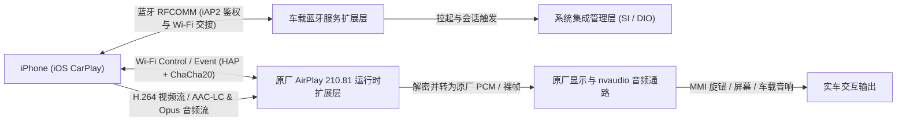

# Audi MHI2 CN P0916 原生无线 CarPlay 研究展示

[English](README_EN.md) | **简体中文**

本项目旨在探索奥迪经典 **MHI2（`MHI2_CN_AU37x_P0916` / MU0916，QNX 6.5 ARM32）** 车机平台上，在不修改或刷写原厂 Flash 分区的前提下，复用车载蓝牙、车载 Wi‑Fi 热点与原厂 `libairplay.so (210.81)` 实现**纯内存原生无线 Apple CarPlay**，并完整保留有线 USB CarPlay 通路。

> [!WARNING]
> **版权与严禁商业化声明**
>
> 本项目全部原创研究成果、文档与代码版权均归作者（**GitHub: `@emotional-lau` / 微博・汽车之家: `@emotional_lau`**）所有，保留一切权利。
>
> **严禁任何未经本人书面授权的商业化行为**（包括但不限于倒卖源码或二进制包、打包售卖、收费代安装/刷机、集成至商用工具箱或盈利性二次分发）。个人仅限在保留本声明的前提下用于非商业性的技术交流与学习。详见 [LICENSE](LICENSE)。

---

> [!IMPORTANT]
> **公开仓库边界说明（研究展示窗）**
>
> - **目前为非完全的阶段性研发进度展示，仅供技术交流与学习研究使用。**
> - 为有效防止被直接复刻或包装倒卖，**本公开仓库仅提供研究文档、系统架构说明以及通用无固件依赖的纯 C 密码学基础库（`src/crypto/`）**。
> - 所有与目标车机绑定的核心实现——包括但不限于原厂 `libairplay.so` / `dio_manager` 内存对象布局与固定地址、运行时 Hook 逻辑、HAP 配对/控制会话状态机、无线音频中继、蓝牙 iAP2 / RFCOMM 集成、离线构建与二进制嫁接工具链、以及实车部署框架——**均在私有仓库中维护，不在此公开仓库分发**。

---

## 一、总体架构思路（概念示意图）

在不改写车机原厂系统分区的前提下，整套方案的核心思路完全围绕**纯内存拦截与原厂组件复用**展开：

---

## 二、当前实车验证进度

- **已实车点亮并验证通过的部分**：
  - 蓝牙 iAP2 鉴权响应与车载 Wi‑Fi 凭据无线交接触发；
  - CarPlay 控制会话自动发现与建立、HAP 配对鉴权与加密控制/事件通道打通；
  - `800×480` H.264 主屏幕画面点亮、MMI 旋钮流畅操作，以及多轮拆流/重建连接稳定性验证。
- **正在联调 / 待完善的未完成部分（非完整版）**：
  - **无线音频通路（实车联调中）**：iPhone 音频输出选择器已可正常识别并切换至 `CarPlay 车载`，媒体播放流配置请求也已成功进入车机并触发 `nvaudio` 音频通路；当前正在排查并修复音频流建链应答校验导致的起播拆流问题；
  - **配对身份持久化与蓝牙链路清理（待完善）**：当前纯内存实验态重启后会重置配对身份，导致每次需重新触发配对及弹窗状态冲突，后续补充安全持久化与会话后蓝牙链路释放；
  - **SIM 卡未插入弹窗抑制（待处理）**；
  - **奥迪虚拟座舱（Virtual Cockpit）仪表地图投屏兼容性（待处理）**。

---

## 三、本公开仓库目录说明

本公开仓库仅保留通用 C 密码学基础实现与 QNX 基础 ABI 类型头（共 3 个文件），**无任何目标固件偏移或车机进程 Hook 代码**：

| 文件 | 说明 |
| --- | --- |
| `src/crypto/wcp_crypto.h` / `wcp_crypto.c` | 纯 C 实现的通用密码学原语（SRP-6a、X25519、Ed25519、SHA-512、HKDF-SHA-512、ChaCha20-Poly1305） |
| `src/crypto/qnx65_abi.h` | QNX 6.5 基础数据结构与 POSIX/Socket 常量声明 |

---

## 四、参考项目与致谢

本项目在前期协议分析与技术架构调研过程中主要参考了以下 4 个开源项目（已分别注明具体参考方向）：

1. **[joeyQuery/MHI2-wirelessCarPlay](https://github.com/joeyQuery/MHI2-wirelessCarPlay)**
   - **参考内容**：经典 MHI2 平台的蓝牙 iAP2 / DIO / AirPlay 边界追踪分析与固件对照研究记录。

2. **[korhojoa/mib2-extenders](https://github.com/korhojoa/mib2-extenders)**
   - **参考内容**：MIB2 High（QNX）平台蓝牙服务生命周期管理、Wi‑Fi 热点接入与系统扩展架构实践。

3. **[luka-dev/mib2q-carplay-rgi](https://github.com/luka-dev/mib2q-carplay-rgi)**
   - **参考内容**：无线 CarPlay 完整协议阶段设计（iAP2 认证与 Wi‑Fi 交接参数、Bonjour 控制发现与连接触发、系统集成管理器架构，以及原厂 AirPlay `210.81` 的配对与流媒体交互边界）。

4. **[congobg/MHI2Q_WiFi_CarPlay](https://github.com/congobg/MHI2Q_WiFi_CarPlay)**
   - **参考内容**：基于原厂 `libairplay.so (210.81)` 的无线音频中继思路（无线 `/info` 音频能力声明、媒体流类型兼容映射、UDP 解码并结合原厂抖动缓冲播放进度限速回喂 PCM，以及麦克风上行编码方案）。

---

## 五、免责声明

- 本仓库仅供车载电子系统、QNX 架构及无线 CarPlay 协议的**个人学习与技术研究交流**，不提供成品刷机包或商业方案。
- 版权归作者（GitHub: `@emotional-lau` / 微博・汽车之家: `@emotional_lau`）所有，禁止一切未经授权的商业化与倒卖行为。详见 [LICENSE](LICENSE)。
