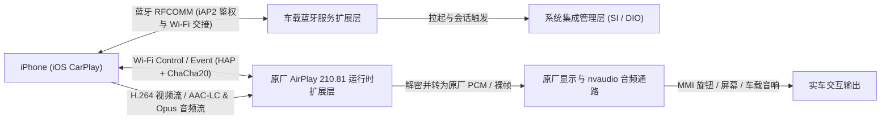

# Audi MHI2 CN P0916 原生无线 CarPlay 研究展示

[English](README_EN.md) | **简体中文**

本项目旨在探索奥迪经典 **MHI2（`MHI2_CN_AU37x_P0916` / MU0916，QNX 6.5 ARM32）** 车机平台上，在不修改或刷写原厂 Flash 分区的前提下，复用车载蓝牙、车载 Wi‑Fi 热点与原厂 `libairplay.so (210.81)` 实现**纯内存原生无线 Apple CarPlay**，并完整保留有线 USB CarPlay 通路。

> [!WARNING]
> **版权与严禁商业化声明**
>
> 本项目全部原创研究成果、文档与代码版权均归作者（**GitHub: `@emotional-lau` / 微博・汽车之家: `@emotional_lau`**）所有，保留一切权利。
>
> **严禁任何未经本人书面授权的商业化行为**（包括但不限于倒卖源码或二进制包、打包售卖、收费代安装/刷机、集成至商用工具箱或盈利性二次分发）。个人仅限在保留本声明的前提下用于非商业性的技术交流与学习。详见 [LICENSE](LICENSE)。

---

> [!IMPORTANT]
> **公开仓库边界说明（研究展示窗）**
>
> - **目前为非完全的阶段性研发进度展示，仅供技术交流与学习研究使用。**
> - 为有效防止被直接复刻或包装倒卖，**本公开仓库仅提供研究文档、系统架构说明以及通用无固件依赖的纯 C 密码学基础库（`src/crypto/`）**。
> - 所有与目标车机绑定的核心实现——包括但不限于原厂 `libairplay.so` / `dio_manager` 内存对象布局与固定地址、运行时 Hook 逻辑、HAP 配对/控制会话状态机、无线音频中继、蓝牙 iAP2 / RFCOMM 集成、离线构建与二进制嫁接工具链、以及实车部署框架——**均在私有仓库中维护，不在此公开仓库分发**。

---

## 一、总体架构思路（概念示意图）

在不改写车机原厂系统分区的前提下，整套方案的核心思路完全围绕**纯内存拦截与原厂组件复用**展开：

---

## 二、当前实车验证进度（2026-11-28）

- **已实车点亮并验证通过的部分**：
  - 蓝牙 iAP2 鉴权与车载 Wi‑Fi 凭据无线交接、CarPlay 控制会话自动发现、HAP 加密控制与事件通道建立；
  - `800×480` H.264 主屏幕画面点亮、MMI 旋钮交互，以及连接管理器手动断开/重连与自动回连稳定性；
  - **无线全路音频已实现零卡顿实车通过**：媒体音乐（48 kHz AAC-LC，针对 iOS 突发发包特性完成预填充与抖动缓冲适配，实测零欠载 `underruns=0`）、导航提示音（Opus 16 kHz）以及双向通话/Siri 语音上行通道（Opus 16 kHz）；
  - **零 Flash 配对持久化与蓝牙交接释放**：冷启动可跳过首次配对直通快速校验，进入无线会话后可优雅释放经典蓝牙链路；
  - **“无数据连接 / 请插入 SIM 卡”弹窗纯内存根治（已实车长时验证通过）**：在不触碰系统 Flash 且不破坏手机蜂窝 4G/5G 上网的前提下，消除连接车载热点触发的无 SIM 弹窗，并完成 `/ramdisk` 运行时瘦身（常驻约 `5.5–6.0 MiB` / `29–30%`），实车连续多分钟双向语音与音乐播放稳定通过；
  - **奥迪虚拟座舱（Virtual Cockpit）仪表副屏地图投屏兼容（已实车验证通过）**：在纯内存架构下与既有仪表投屏补丁稳定共存，实车验证仪表副屏地图与导航投屏清晰流畅、主副屏切换稳定，并与 48 kHz 音乐 / 16 kHz 导航语音并发零欠载运行；
  - **网络栈长时稳定性多轮实车复核通过（33.7 分钟 + 今日 5 轮均 0 崩溃）**：在前期 33.7 分钟全负载零崩溃突破的基础上，今日继续完成 5 轮独立实车听歌与功能联调（主屏、虚拟座舱副屏地图、48 kHz 音乐并发运行），全程 **`0` 崩溃、`0` 报错、全路音频零欠载（`underruns=0`）**，`/ramdisk` 稳定保持约 `29–30%`。
- **下一阶段收尾待完善部分（非完整版）**：
  - **仪表盘无线音频曲目信息显示**：已完成专用 DataStream 通道方案的多轮单变量实车对照排查并正式排除该通道路径，下一步切换至另一条标准控制命令传输通道继续联调，复用现有元数据解析与状态同步逻辑；
  - **日常运行模式与最终边界回归**：免单次触发开关、日志轮转，以及 Siri/车载麦克风/来去电切换、有线 CarPlay 与原厂蓝牙音频零回归验收。

### 附：与 `chefranov/mhi2-au37x-carplay` 仪表项目的无线适配进度

| 功能模块 | 适配状态 | 说明 |
| --- | --- | --- |
| **仪表全屏地图 / 导航副屏投屏** | **✅ 已实车验证通过** | 纯内存架构下与原仪表补丁稳定共存，画面清晰流畅、主副屏切换稳定，并发音频零欠载 |
| **仪表来电 / 通话信息与跳过 CarPlay 提示** | **✅ 天然兼容可用** | 直接复用原厂系统接口，无线模式下同步生效 |
| **仪表盘无线音频曲目与进度显示** | **🔄 切换备用控制通道联调** | 已通过多轮实车单变量测试正式排除专用 DataStream 通道，下一步切入标准控制命令传输通道闭环联调 |
| **仪表专辑封面显示** | **📋 后续规划** | 待无线元数据通道稳定后扩展封面数据传输桥接 |
| **仪表 3D 转向箭头卡片与电话列表/回拨** | **📋 后续规划** | 原方案依赖有线协议链路，无线模式下待通用控制通道打通后评估并桥接支持 |

## 三、本公开仓库目录说明

本公开仓库仅保留通用 C 密码学基础实现与 QNX 基础 ABI 类型头（共 3 个文件），**无任何目标固件偏移或车机进程 Hook 代码**：

| 文件 | 说明 |
| --- | --- |
| `src/crypto/wcp_crypto.h` / `wcp_crypto.c` | 纯 C 实现的通用密码学原语（SRP-6a、X25519、Ed25519、SHA-512、HKDF-SHA-512、ChaCha20-Poly1305） |
| `src/crypto/qnx65_abi.h` | QNX 6.5 基础数据结构与 POSIX/Socket 常量声明 |

---

## 四、参考项目与致谢

本项目在前期协议分析与技术架构调研过程中主要参考了以下 5 个开源项目（已分别注明具体参考方向）：

1. **[joeyQuery/MHI2-wirelessCarPlay](https://github.com/joeyQuery/MHI2-wirelessCarPlay)**
   - **参考内容**：经典 MHI2 平台的蓝牙 iAP2 / DIO / AirPlay 边界追踪分析与固件对照研究记录。

2. **[korhojoa/mib2-extenders](https://github.com/korhojoa/mib2-extenders)**
   - **参考内容**：MIB2 High（QNX）平台蓝牙服务生命周期管理、Wi‑Fi 热点接入与系统扩展架构实践。

3. **[luka-dev/mib2q-carplay-rgi](https://github.com/luka-dev/mib2q-carplay-rgi)**
   - **参考内容**：无线 CarPlay 完整协议阶段设计（iAP2 认证与 Wi‑Fi 交接参数、Bonjour 控制发现与连接触发、系统集成管理器架构，以及原厂 AirPlay `210.81` 的配对与流媒体交互边界）。

4. **[congobg/MHI2Q_WiFi_CarPlay](https://github.com/congobg/MHI2Q_WiFi_CarPlay)**
   - **参考内容**：基于原厂 `libairplay.so (210.81)` 的无线音频中继思路（无线 `/info` 音频能力声明、媒体流类型兼容映射、UDP 解码并结合原厂抖动缓冲播放进度限速回喂 PCM，以及麦克风上行编码方案）。

5. **[chefranov/mhi2-au37x-carplay](https://github.com/chefranov/mhi2-au37x-carplay)**
   - **参考内容**：面向奥迪 MHI2 AU37x 虚拟座舱的仪表 CarPlay 副屏投屏与扩展项目；本项目针对车主实车已装环境完成了纯内存无线共存适配，并持续推进相关仪表扩展功能的无线化支持。

---

## 五、免责声明

- 本仓库仅供车载电子系统、QNX 架构及无线 CarPlay 协议的**个人学习与技术研究交流**，不提供成品刷机包或商业方案。
- 版权归作者（GitHub: `@emotional-lau` / 微博・汽车之家: `@emotional_lau`）所有，禁止一切未经授权的商业化与倒卖行为。详见 [LICENSE](LICENSE)。
