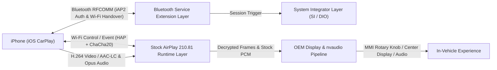

# Audi MHI2 CN P0916 Native Wireless CarPlay Research Showcase

**English** | [简体中文](README.md)

This project investigates **pure-RAM native wireless Apple CarPlay** on the classic Audi **MHI2 (`MHI2_CN_AU37x_P0916` / MU0916, QNX 6.5 ARM32)** head unit—reusing the onboard Bluetooth, vehicle Wi‑Fi access point, and stock `libairplay.so (210.81)` without modifying OEM flash partitions, while preserving wired USB CarPlay.

> [!WARNING]
> **Copyright & Anti-Commercialization Notice**
>
> All copyrights to the original research notes, documentation, and source code in this repository belong exclusively to the author (**GitHub: `@emotional-lau` / Weibo & Autohome: `@emotional_lau`**), All Rights Reserved.
>
> **Unauthorized commercialization of any kind is strictly prohibited** (including reselling source code or builds, paid installation/flashing services, commercial bundling, or for-profit redistribution). Viewing and discussion are permitted strictly for personal, non-commercial study provided this notice remains intact. See [LICENSE](LICENSE).

---

> [!IMPORTANT]
> **Public Repository Scope (Research Showcase)**
>
> - **This is an incomplete, work-in-progress research showcase intended strictly for technical discussion and learning.**
> - To prevent commercial cloning and unauthorized reselling, **this public repository contains only architecture documentation, progress tracking, and standalone firmware-independent C cryptographic primitives (`src/crypto/`)**.
> - All head-unit-specific components—including `libairplay.so` / `dio_manager` object layouts and fixed addresses, runtime Hook implementations, HAP pairing/control state machines, the wireless audio relay, Bluetooth iAP2/RFCOMM integration, build/graft toolchains, and vehicle deployment frameworks—**are kept in a private repository and are not distributed publicly**.

---

## 1. High-Level Architecture Concept

Without altering OEM flash partitions, the approach focuses on pure-RAM runtime interposition and reuse of existing OEM infotainment subsystems:

---

## 2. Current Real-Vehicle Progress (2026-11-25)

- **Verified & working on real vehicle**:
  - Bluetooth iAP2 authentication and Wi‑Fi credential handover, CarPlay control session discovery, HAP pairing/verification, and `ChaCha20-Poly1305` encrypted control & event channels;
  - `800×480` H.264 main display projection, smooth MMI rotary knob control, and stable manual disconnect/reconnect & auto-reconnect via the MMI Connection Manager;
  - **Zero-stutter wireless audio across all paths**: Buffered media playback (48 kHz AAC-LC tuned for iOS Wi‑Fi burst pacing, verified with `underruns=0` on real vehicle), navigation prompts (Opus 16 kHz), and bidirectional telephony/Siri uplink (Opus 16 kHz);
  - **Zero-flash pairing persistence & graceful Bluetooth release**: Cold boots skip initial pairing via persisted identity verification, and Classic Bluetooth links are cleanly released once wireless CarPlay starts;
  - **Pure-RAM No-SIM popup suppression (verified on real vehicle)**: Eliminates the OEM "No data connection / Please insert SIM card" popup triggered when joining the vehicle AP—with zero flash writes and full preservation of iPhone 4G/5G cellular data—paired with `/ramdisk` footprint slimming (~5.5 MiB / 29% steady-state) verified across multi-minute continuous voice call and music sessions.
- **Next-phase polish & remaining items (work in progress)**:
  - **Audi Virtual Cockpit integration**: Coexistence with existing cluster map projection patches and bridging wireless Now Playing track metadata to the cluster;
  - **Daily auto-run mode & final boundary regression**: Trigger-free daily SD startup, log rotation, and full regression checks across Siri/mic uplink, telephony, wired USB CarPlay, and OEM Bluetooth audio.

## 3. Public Directory Contents

This public showcase includes only standalone generic C cryptographic primitives and QNX base ABI type headers (3 source files), containing **no target firmware offsets or head-unit Hook implementations**:

| File | Description |
| --- | --- |
| `src/crypto/wcp_crypto.h` / `wcp_crypto.c` | Standalone C cryptographic primitives (SRP-6a, X25519, Ed25519, SHA-512, HKDF-SHA-512, ChaCha20-Poly1305) |
| `src/crypto/qnx65_abi.h` | Generic QNX 6.5 base types and POSIX/Socket constant definitions |

---

## 4. Referenced Projects & Attribution

Research and protocol analysis referenced the following 4 open-source projects (with specific areas credited):

1. **[joeyQuery/MHI2-wirelessCarPlay](https://github.com/joeyQuery/MHI2-wirelessCarPlay)**
   - **Referenced for**: Classic MHI2 Bluetooth iAP2 / DIO / AirPlay boundary tracing and firmware comparison notes.

2. **[korhojoa/mib2-extenders](https://github.com/korhojoa/mib2-extenders)**
   - **Referenced for**: MIB2 High (QNX) Bluetooth service lifecycle management, Wi‑Fi AP integration, and platform extension architecture.

3. **[luka-dev/mib2q-carplay-rgi](https://github.com/luka-dev/mib2q-carplay-rgi)**
   - **Referenced for**: Wireless CarPlay protocol stages (iAP2 authentication & Wi‑Fi handover parameters, Bonjour control discovery & session trigger, system integrator architecture, and stock AirPlay `210.81` pairing/streaming boundaries).

4. **[congobg/MHI2Q_WiFi_CarPlay](https://github.com/congobg/MHI2Q_WiFi_CarPlay)**
   - **Referenced for**: Stock `libairplay.so (210.81)` wireless audio relay design (`/info` audio format advertisement, stream type mapping, UDP decoding paced against the stock jitter buffer playhead into PCM, and Opus microphone uplink).

---

## 5. Disclaimer

- This repository is shared strictly for **personal technical learning and research** into automotive QNX systems and wireless CarPlay protocols; no plug-and-play packages or commercial solutions are provided.
- Copyright belongs exclusively to the author (GitHub: `@emotional-lau` / Weibo & Autohome: `@emotional_lau`). Unauthorized commercial use or reselling is strictly prohibited. See [LICENSE](LICENSE).
